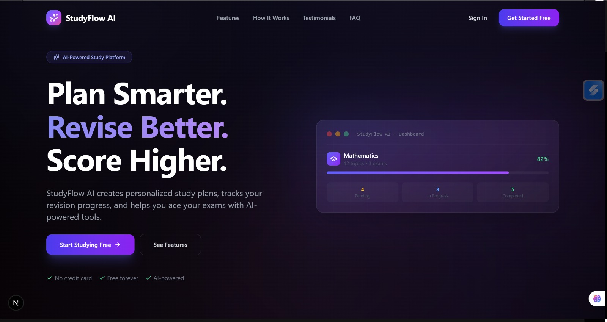
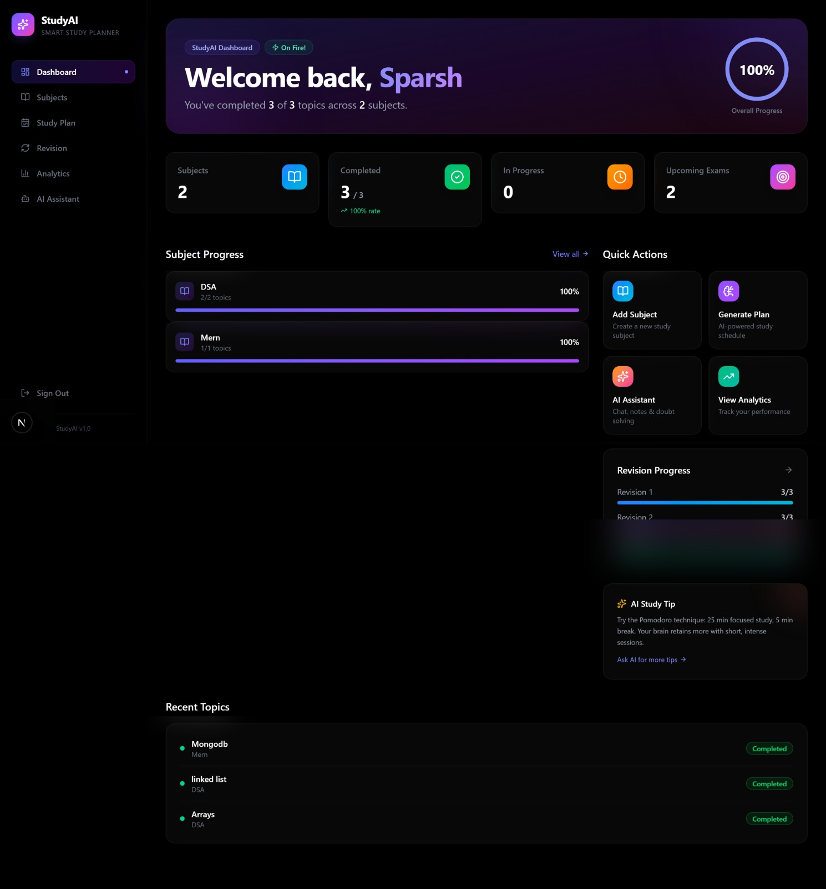
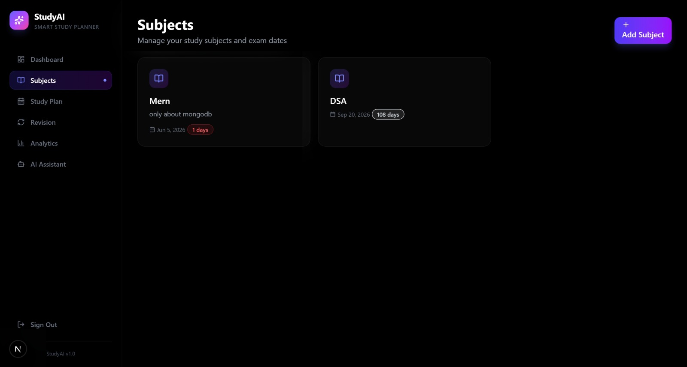
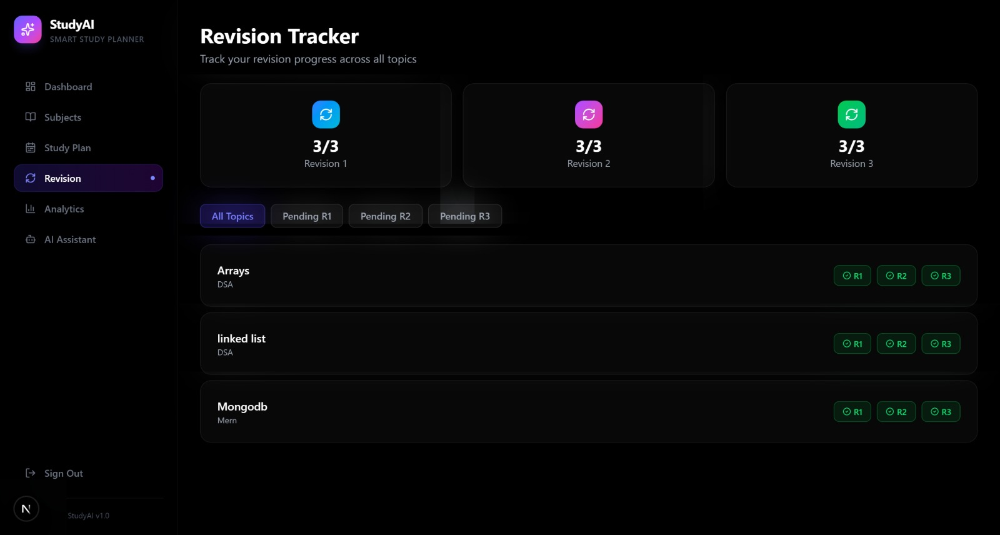
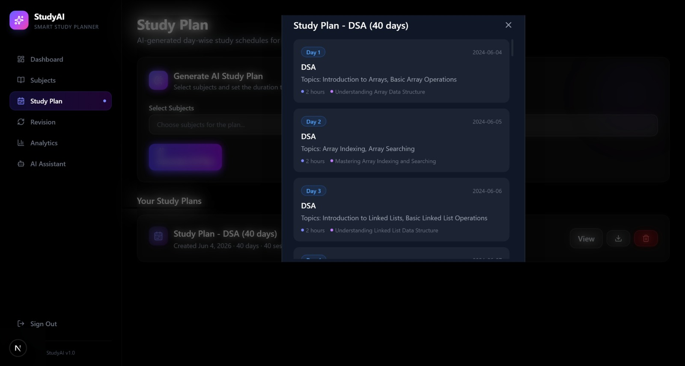
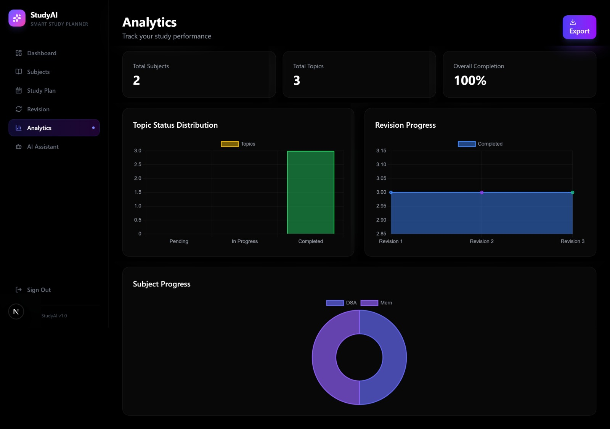
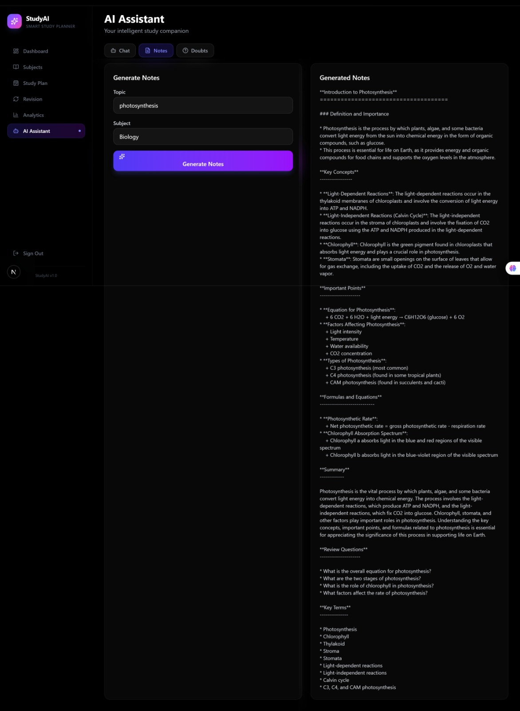

#Live Link

https://study-ai-u1l3.vercel.app/

# 📚 StudyAI

StudyAI is an AI-powered study management platform designed to help students organize their learning, track revision progress, and improve productivity. The application provides subject management, revision tracking (R1, R2, R3), progress analytics, and note-taking features through a modern and responsive interface.

---

## ✨ Features

* 🔐 Secure Authentication with email confirmation
* 📖 Subject & Topic Management
* ✅ Revision Tracking (R1, R2, R3)
* 📊 Progress Analytics Dashboard
* 📝 Notes Management
* 📅 Study Planning & Tracking
* 📱 Responsive Design
* ☁️ Cloud Database with Supabase

---

## 🖼️ Screenshots

### Landing Page



### Dashboard



### Subject Management



### Revision Tracker



### Study Plan



### Analytics



### AI Features


---

## 🚀 Tech Stack

* React 19 + Vite
* React Router
* Tailwind CSS
* Express 5 (API server)
* Supabase (Auth + PostgreSQL)
* Groq (AI assistant)

---

## 🛠️ Installation

Clone the repository:

```bash
git clone https://github.com/Sparsh9844/StudyAI.git
cd StudyAI
```

Install dependencies (Node.js 20 or newer):

```bash
npm install
```

Copy `.env.example` to `.env.local` and fill in your values:

```env
NEXT_PUBLIC_SUPABASE_URL=your_supabase_url
NEXT_PUBLIC_SUPABASE_ANON_KEY=your_supabase_anon_key
GROQ_API_KEY=your_groq_api_key
```

Run the frontend and API together:

```bash
npm run dev:all
```

Open:

```text
http://localhost:3000
```

---

## ☁️ Deployment (Vercel)

The frontend is served from Vercel's CDN and the Express API runs as a
single serverless function (`api/index.js`). `vercel.json` holds the build
settings, routing and headers.

1. Import the GitHub repo in Vercel (settings are read from `vercel.json`).
2. Add the environment variables from `.env.example` under
   **Project → Settings → Environment Variables**.
3. In Supabase → **Authentication → URL Configuration**, set **Site URL** to
   your Vercel domain and add `https://<your-domain>/auth/reset-password`
   to **Redirect URLs**.

To self-host instead: `npm run build && npm start` serves the app and API
from one Express process.

---

## 📂 Project Structure

```text
StudyAI/
├── api/            # Vercel serverless entry (wraps the Express app)
├── server/         # Express API: auth session cookies, AI routes
├── src/
│   ├── app/        # Pages (one folder per route)
│   ├── components/ # Layout and UI components
│   ├── data/       # Static study content (DSA sheet, Core CS, aptitude)
│   ├── hooks/
│   ├── lib/
│   └── services/
├── public/
├── vercel.json
└── README.md
```

---

## 🎯 Future Improvements

* AI-generated study recommendations
* Smart revision scheduling
* PDF report generation
* Study streak tracking
* Mobile application support
* AI-powered note summaries

---

## 👨‍💻 Author

Developed by Sparsh Chauhan as a student productivity and revision management platform.

If you found this project useful, consider giving it a ⭐ on GitHub.
