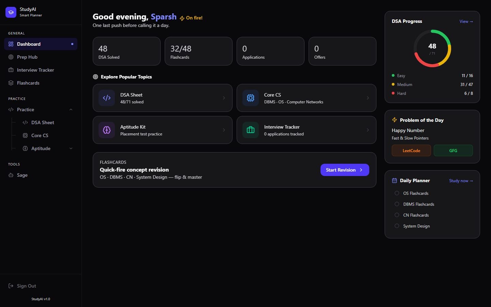
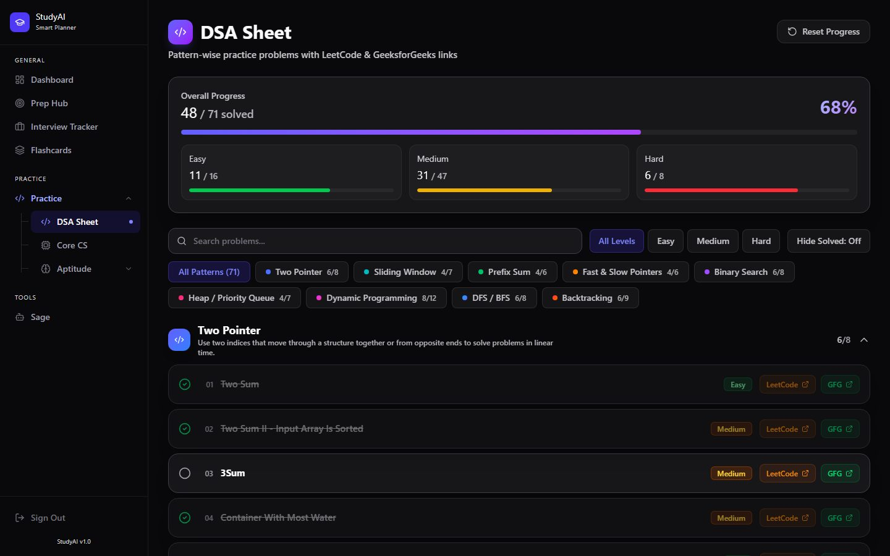
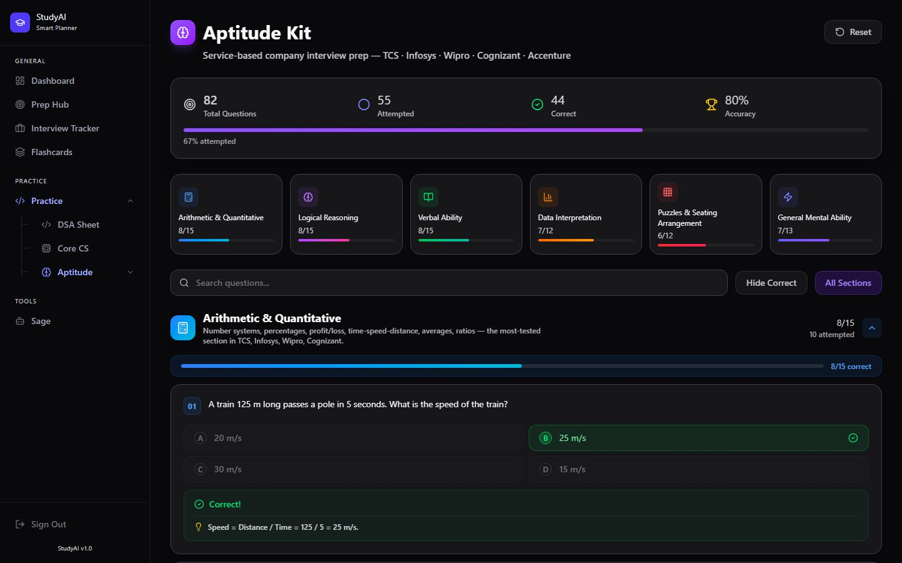
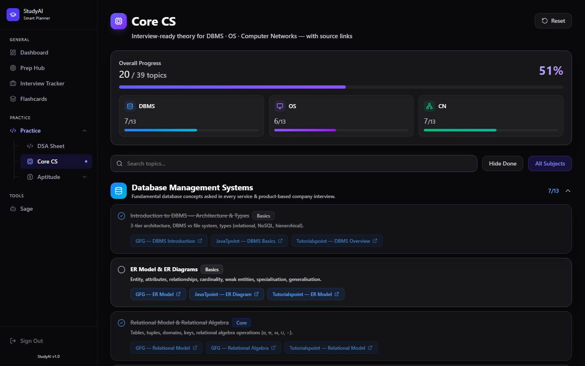
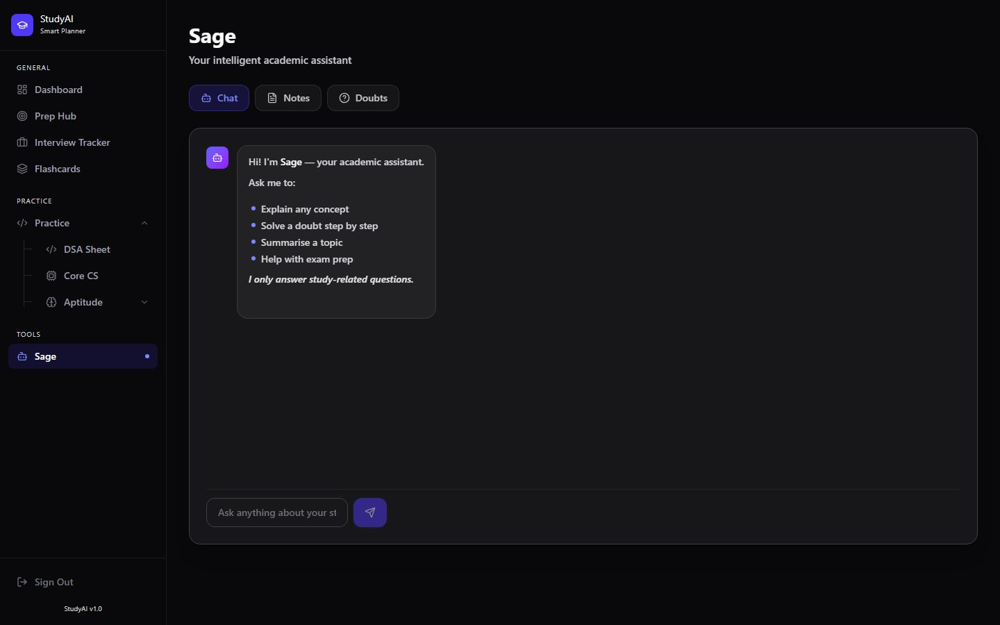
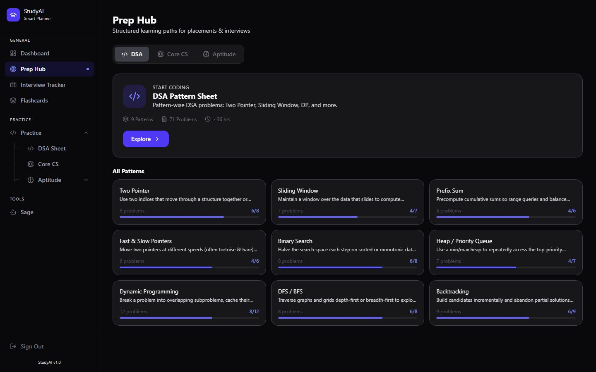
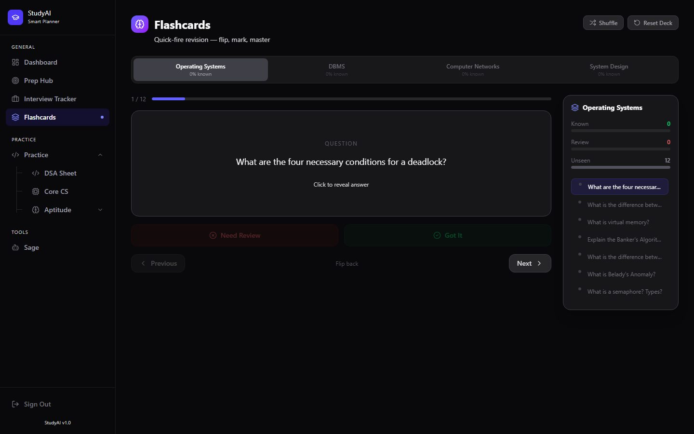
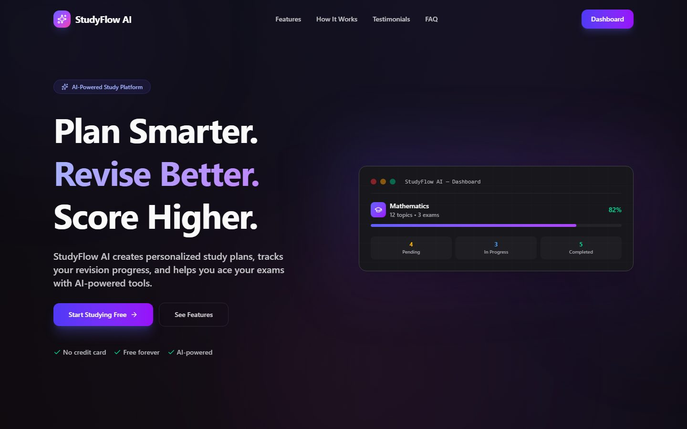

# 📚 StudyAI (StudyFlow AI)

**Live:** https://study-ai-mu-lime.vercel.app

StudyAI is an AI-powered placement and interview prep platform. It brings together a pattern-wise DSA sheet, an aptitude kit for company tests, Core CS theory, flashcards and an interview tracker, plus **Sage**, an AI assistant that explains concepts, solves doubts and writes notes. Your progress is saved to your account, so you can pick up where you left off.

---

## ✨ Features

| Feature | What it does |
|---|---|
| 🧩 **DSA Sheet** | 71 problems across 9 patterns (Two Pointer, Sliding Window, Prefix Sum, Fast & Slow Pointers, Binary Search, Heap, Dynamic Programming, DFS/BFS, Backtracking), with LeetCode and GeeksforGeeks links, difficulty filters and search |
| 🧮 **Aptitude Kit** | 82 questions with worked solutions across Quantitative, Logical Reasoning, Verbal Ability, Data Interpretation, Puzzles & Seating Arrangement and General Mental Ability, with accuracy tracking (TCS, Infosys, Wipro, Cognizant, Accenture style) |
| 🖥️ **Core CS** | 39 interview-ready topics in DBMS, Operating Systems and Computer Networks, each with curated source links |
| 🤖 **Sage AI** | AI assistant with **Chat**, **Doubts** (step-by-step solutions) and **Notes** (generate notes for any topic) modes, powered by Groq |
| 🃏 **Flashcards** | 48 quick-fire cards in OS, DBMS, CN and System Design decks; flip, mark as known or review, shuffle |
| 💼 **Interview Tracker** | Track every application from Applied → Online Assessment → Interview → Offer |
| 🎯 **Prep Hub** | Structured learning paths that bring DSA, Core CS and Aptitude together |
| 📊 **Dashboard** | DSA progress by difficulty, Problem of the Day, daily planner, flashcard and interview pipeline stats |
| 🔐 **Accounts** | Supabase auth (sign up, login, password reset) with progress kept separately for each account |

---

## 🖼️ Screenshots

### Dashboard


### DSA Sheet


### Aptitude Kit


### Core CS


### Sage AI Assistant


### Prep Hub


### Flashcards


### Landing Page


---

## 🚀 Tech Stack

* React 19 + Vite
* React Router
* Tailwind CSS
* Express 5 (API server, deployed as a Vercel serverless function)
* Supabase (Auth + PostgreSQL)
* Groq (Sage AI assistant)

---

## 🛠️ Installation

Clone the repository:

```bash
git clone https://github.com/Sparsh9844/StudyAI.git
cd StudyAI
```

Install dependencies (Node.js 20 or newer):

```bash
npm install
```

Copy `.env.example` to `.env.local` and fill in your values:

```env
NEXT_PUBLIC_SUPABASE_URL=your_supabase_url
NEXT_PUBLIC_SUPABASE_ANON_KEY=your_supabase_anon_key
GROQ_API_KEY=your_groq_api_key
```

Run the frontend and API together:

```bash
npm run dev:all
```

Open:

```text
http://localhost:3000
```

---

## ☁️ Deployment (Vercel)

The frontend is served from Vercel's CDN and the Express API runs as a
single serverless function (`api/index.js`). `vercel.json` holds the build
settings, routing and headers.

1. Import the GitHub repo in Vercel (settings are read from `vercel.json`).
2. Add the environment variables from `.env.example` under
   **Project → Settings → Environment Variables**.
3. In Supabase → **Authentication → URL Configuration**, set **Site URL** to
   your Vercel domain and add `https://<your-domain>/auth/reset-password`
   to **Redirect URLs**.

To self-host instead: `npm run build && npm start` serves the app and API
from one Express process.

---

## 📂 Project Structure

```text
StudyAI/
├── api/            # Vercel serverless entry (wraps the Express app)
├── server/         # Express API: auth session cookies, AI routes
├── src/
│   ├── app/        # Pages (one folder per route)
│   ├── components/ # Layout and UI components
│   ├── data/       # Static study content (DSA sheet, Core CS, aptitude, flashcards)
│   ├── hooks/
│   ├── lib/
│   └── services/
├── public/
├── vercel.json
└── README.md
```

---

## 🎯 Future Improvements

* AI-generated study recommendations
* Smart revision scheduling
* PDF report generation
* Study streak tracking
* Mobile application support
* AI-powered note summaries

---

## 👨‍💻 Author

Developed by [Sparsh Chauhan](https://sparsh-chauhan.vercel.app) as an all-in-one placement and interview prep platform.

If you found this project useful, consider giving it a ⭐ on GitHub.
